# Setup UI — building and maintaining a rig

**Last updated:** 2026-08-17

The setup UI is where a rig is *defined and serviced*: which Pis exist, which devices
hang off them, what pins and calibrations they use, and how code gets onto the hardware.
You use it when building a rig, after changing wiring, after editing code, and for
projector calibration. You do **not** use it to run a session — that is the
[Experiment tab](EXPERIMENT_UI.md). Since the multi-rig controller, Pi names / IPs / roles are
edited in the **Network** tab, rigs are created and deleted there too, and Setup shows one sub-tab
per loaded rig ([MULTI_RIG.md](MULTI_RIG.md)).

```bash
conda activate vrfarm
python controller/app.py     # http://localhost:5000 -> Setup tab
```

It writes `rigs/<name>.yaml` and `display_calibration/<rig>/geometry/rig_geometry_<stamp>.yaml` (plus intensity files in `display_calibration/<rig>/intensity/`), and together
with the Data tab it is the part of VRFarm that uses SSH — Install, Reboot, Shutdown, warp generation and
geometry calibration all shell out over `ssh`/`scp`. See
[CONTROLLER_SETUP.md §2](CONTROLLER_SETUP.md#2-passwordless-ssh-to-the-pis) if those
fail with a password prompt.

> Every screenshot below is the hardware-free `demo` rig (both Pis on `127.0.0.1`,
> answered by `tools/mock_pi.py`). Regenerate them all with
> `python tools/capture_ui_shots.py`.

---

## The page at a glance

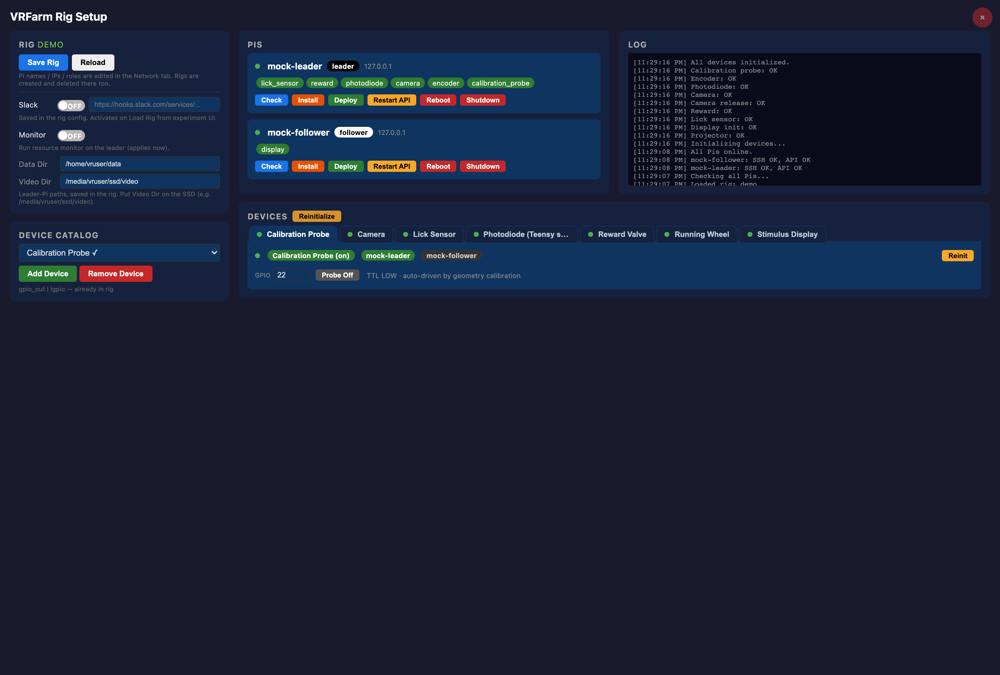

Three columns, and the layout maps onto the workflow:

| Region | Card | What it is for |
|---|---|---|
| Left | **Rig** | Load / create / save a rig file; Slack; the Leader's data + video paths |
| Left | **Pi Management** | Add, edit and remove Pis in the loaded rig |
| Left | **Device Catalog** | Add or remove device *types* from the rig |
| Middle | **Pis** | One card per Pi: status dot, assigned devices, and the six service actions |
| Middle | **Devices** | A tab per device with its live controls — the working area |
| Right | **Log** | Reverse-chronological; every action reports here. Read it when something fails |

The red **×** at top right stops the Flask server.

---

## Order of operations

The UI enforces a strict sequence through button enablement. Fighting it is the most
common source of "why is everything greyed out".

```
Load Rig ──> Check (per Pi, automatic) ──> Initialize ──> device controls unlock
   │                                           ▲
   └─ Install (fresh Pi, once) ── Deploy ──────┘   (both revert devices to uninitialized)
```

1. **Nothing works before a rig is loaded.** Add Pi, Add Device and the update controls
   all bail with *"Load or create a rig first"*. On a cold start the Pis and Devices areas
   are empty and **Initialize** is greyed:

   
2. **Load Rig auto-checks every Pi.** There is no Connect button; per-Pi **Check** is the
   manual re-run.
3. **Initialize is the master gate.** It stays disabled until *every* Pi answers on its
   REST API. Until it succeeds, every device panel is greyed with *"Waiting for Pi
   check..."* or *"Press Initialize to enable device controls."*
4. **Deploy and Restart API un-initialize everything.** Both restart `pi_api` on the Pi,
   which drops the device handles — the dots go grey and you press **Initialize** again.
   This is expected, not a failure.

Straight after Load Rig the Pis are green and **Initialize** has gone live, but the device
area is still empty — that is the moment to press it:

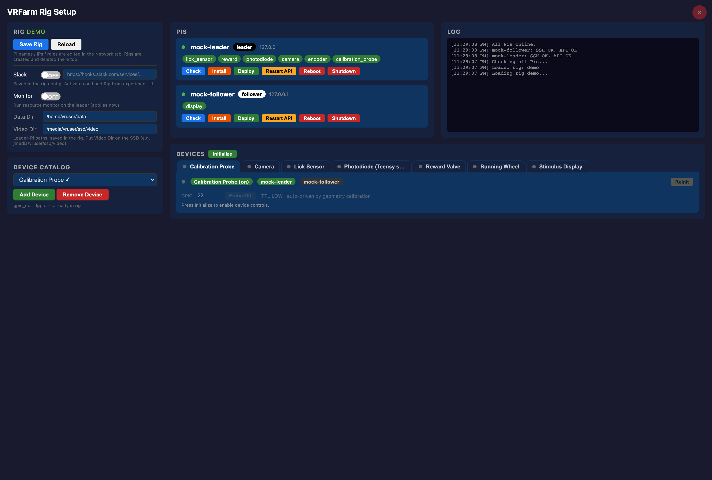

---

## Rig card

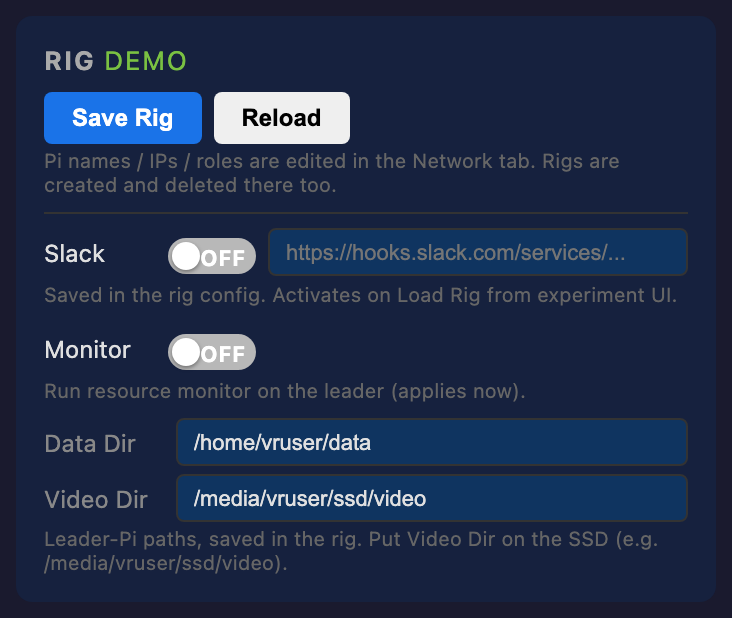

| Control | Effect |
|---|---|
| **Load Rig** | Reads `rigs/<name>.yaml`, then automatically checks the warp map and every Pi |
| **New Rig** | Prompts for a name and **immediately writes** `rigs/<name>.yaml` — a same-named rig is overwritten without warning |
| **Save Rig** | Writes the rig YAML **and** the currently loaded geometry file in one click |
| Slack + webhook | Stored in the rig; the *experiment* UI activates it on its own Load Rig |
| **Monitor** toggle | Starts/stops [shepherd](../shepherd/README.md), the health watchdog on the Leader. Applies immediately, and is re-applied on Install |
| Data Dir / Video Dir | **Leader-side** paths. Point Video Dir at the SSD — the Leader's card cannot hold video |

`Save Rig` is the single persistence point. Pi edits, device assignments, pin numbers,
calibration tables and geometry parameters all live in memory until you press it.

---

## Pi Management

Add a Pi with **Name / IP / User / Role**; `role` must be `leader` or `follower`. To edit
one, pick it under *Target Pi*, choose the field, type the new value, **Update Pi**. Name
and IP collisions are rejected, and changing an IP migrates that Pi's status internally.

All three buttons are client-side only — **Save Rig** persists them.

## Device Catalog

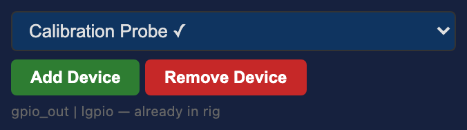

The dropdown lists every registered device class, with `✓` on those already in the rig.
The grey line underneath shows its I/O type and required packages (e.g.
`gpio_out | lgpio`) — that is what **Install** will put on the Pi.

Adding a device puts it in the rig but **not on a Pi**. You must then open its tab and
click the Pi-name chip to assign it. An unassigned device can never initialize.

---

## Per-Pi actions

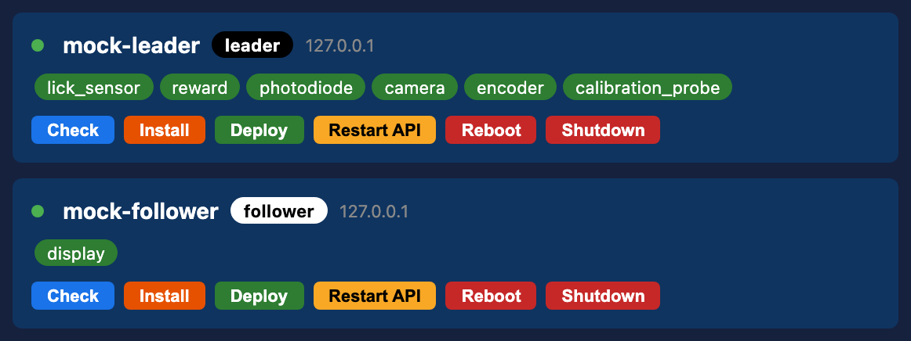

The dot is **green** when both SSH and the Pi's REST API answer, **yellow** when SSH works but pi_api
does not (Install or Restart API fixes that), **red** when SSH fails, grey until checked. The chips are
its assigned devices.

| Button | What it does | When to use it | Risk |
|---|---|---|---|
| **Check** | SSH `echo ok` + `GET /api/status` | Any time; ~5 s | none |
| **Install** | Full first-time provisioning: conda `rig` env pinned to the system Python, apt packages (among them `rsync` and `chrony`, which replaces the image's `systemd-timesyncd`; the Log then shows `Time sync: …` or a WARN), I²C enable, binding symlinks, pip, the Teensy toolchain on the photodiode Pi, all code, `config.txt`/`xorg.conf`, systemd units, time zone `Europe/Vienna` | **Once**, on a fresh Pi | **Minutes; rewrites boot config.** Needs passwordless sudo. Reboot the follower afterwards |
| **Deploy** | Uploads current code, restarts shepherd (leader) and `pi_api`. The restart is timed: the leader's shepherd then waits that long ×1.5 (5–60 s) before reporting pi_api down | After **every** code change | Drops initialized devices |
| **Restart API** | Asks `pi_api` to self-kill; systemd respawns it. Timed like Deploy | When the API is wedged | Drops initialized devices |
| **Reboot** | `sudo reboot` | After Install on the follower | Pi offline ~40 s |
| **Shutdown** | `sudo shutdown -h now` | End of life | **Needs physical access to power back on** |

**Install** is disabled when SSH fails; the other five are disabled when the API is down.
A Pi showing *"SSH FAIL, API OK"* still works for everything except Install.

---

## Initialize

Press **Initialize** (in the Devices header) once all Pis are green. It initializes each
enabled device on its assigned Pi in a fixed order — display first, then lick sensor,
reward, camera, photodiode, encoder, calibration probe, optogenetics, IR illuminator — and
reports each in the Log.


Afterwards the button becomes yellow **Reinitialize**, each tab carries a status dot
(green = up, red = failed, grey = untried), and every panel's controls unlock. A device
that is switched off shows a dimmed label. Per-card **Reinit** re-runs a single device
without touching the others — the fastest way to recover one failed sensor.

---

## Device cards

Each card edits **rig-config** values — pins, addresses, calibration — not task
parameters. Task parameters live in `experiments/*.yaml` and are edited in the
experiment UI.

### Camera

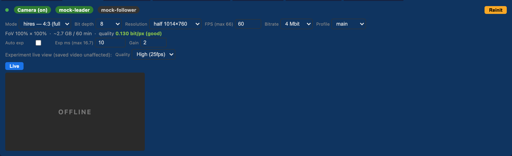

Stream settings are locked while streaming — press **Stop** to change them. `Exp ms` is
clamped to `1000/fps`, and the frame rate is clamped to the sensor's ceiling so you cannot
over-request one and silently under-deliver.

| Control | What it sets |
|---|---|
| **Mode** | Sensor readout mode — the raw window the sensor scans (e.g. `2028×1520`). Determines the field of view and the achievable frame rate |
| **Resolution** | The encoded output size, downscaled from the sensor mode |
| **FPS** / **Bit depth** | Frame rate and sensor bit depth. Higher bit depth costs bandwidth and caps the frame rate |
| **Bitrate** / **Profile** | H.264 target bitrate and profile. The Pi 5 has no hardware encoder, so these directly drive CPU load — see [shepherd](../shepherd/README.md) |
| **Auto exp** / **Exp ms** / **Gain** | Exposure. Manual fields grey out under Auto |
| **Quality** (*Experiment live view*) | Preview only — never affects the recorded file |

The grey line under the controls is derived live from those settings — field of view
retained, projected file size per hour, and encode quality in bits/pixel. Use it to trade
resolution against disk before a long session rather than discovering the cost afterwards.

**Live** is disabled until the camera has initialized; the grey `OFFLINE` box is the
placeholder before a stream starts.

### Stimulus Display

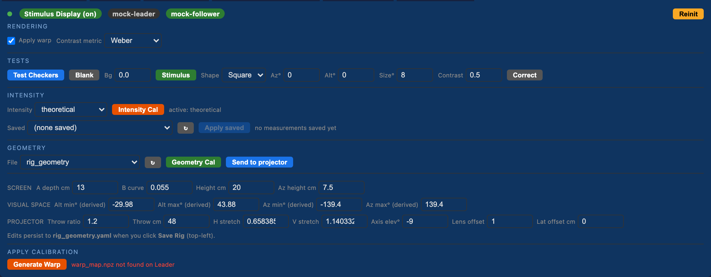

The densest panel in the app, in four blocks:

- **RENDERING** — whether the warp map is applied, and which contrast metric the rig
  authors in (Weber / Michelson / Normalized). Changing the metric reinterprets every
  existing task YAML, so set it once per rig.
- **TESTS** — **Test Checkers** for focus and geometry, **Blank** to set the background
  to a plain 0–1 gray, **Stimulus** to place a patch at an azimuth/altitude. **Correct**
  clamps the typed contrast to what the display can actually reach at that background.
- **CALIBRATION** — **Calibrate** opens the landmark tool (below); **Intensity** selects
  the luminance-correction mode.
- **GEOMETRY** — the screen/projector model. The four **VISUAL SPACE** fields are
  derived, not editable: altitudes are computed in the browser, azimuths are ray-traced
  by the server as you type. Edits here are written when you press **Save Rig**.

### Reward Valve

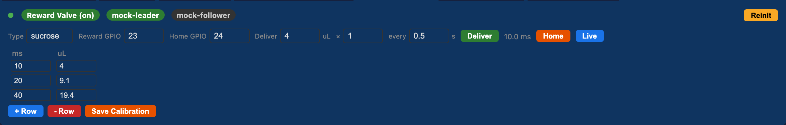

Set the GPIO pins, then build the **ms → µL** calibration table with **+ Row**, and press
**Save Calibration**. **Deliver** interpolates the pulse width for the requested volume
and fires it *n* times at the given interval — that is how you prime the line and verify
the table. The **Home** button only appears if a home pin is configured. Full procedure:
[CALIBRATION_PROTOCOL.md](CALIBRATION_PROTOCOL.md).

### Lick Sensor

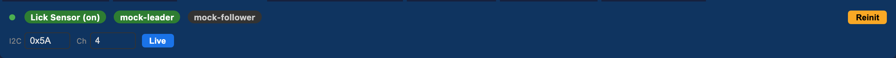

Set the I²C address (`0x5A`) and the electrode channel, press **Live**, and touch the
spout — ticks appear on the 30-second raster and *Last lick* updates. If nothing
registers, confirm the electrode number matches the wiring before suspecting the sensor.

**Debounce (ms)** is the lick refractory period: the MPR121's *release* debounce, so after a
touch the spout must read released for this long before the next lick can count (default 50,
0 = off). Touch detection itself is not delayed. The value is rounded to the sensor's filter
period — the hint next to the field shows the effective value, and the init log reports what
the chip actually measured. It lives in the rig YAML (`devices.lick_sensor.debounce_ms`):
**Save Rig**, then **Reinit** to apply it here, and **Deploy** ships it to the session engine.

### Photodiode

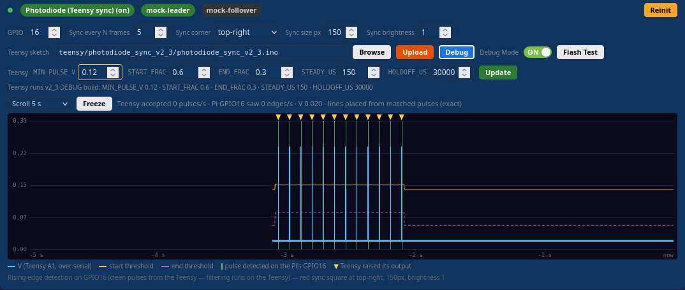

The photodiode timestamps sync pulses from the Teensy. The `Sync ...` fields are authored
here but consumed by the **display** — they control the red patch the projector draws.
Filtering lives on the Teensy, so the card's second and third rows work on its firmware (the
picture is the mock rig: a real trace is not this square):

- **Teensy sketch** / **Browse** — the rig's `.ino`; the choice is saved in the rig YAML
  (`devices.photodiode.teensy_sketch`) at once.
- **Upload** — writes the five Teensy parameters of the row below into the sketch, compiles and
  flashes the production build on the Pi that owns the photodiode, and turns Debug Mode off.
- **Debug** — with Debug Mode off it first flashes the DEBUG build (the sketch file is not
  changed), then opens the live trace: the voltage the Teensy reads, its two thresholds, a yellow
  triangle where the Teensy raised its output and a green line where the Pi's GPIO saw the pulse.
  With Debug Mode on it only shows / hides the trace.
- **Debug Mode** — an indicator of which build the Teensy runs, as the Teensy reports it.
- **Flash Test** — tells the display Pi to flash the patch until **Stop test**, so the whole
  optical path can be checked in one click, with or without the trace.
- **Update** (enabled while the trace is open) — sends the five parameters to the running DEBUG
  build over serial. They last until the next upload or power cycle; **Upload** makes them permanent.

**Initialize** flashes the patch for about a second and fails the photodiode (red dot) when
flashes are missed. The device stays open all the same, so Debug, Flash Test and Update work on
a rig that fails this check — that is what they are for. Sessions run on the production build:
finish a tuning with **Upload**. The toolchain is installed on the Pi first if missing, and a
fresh Teensy (RawHID) is rebooted over HID into its bootloader, so no button press is needed.
Details and how to read the trace: [TEENSY_INSTRUCTIONS.md](TEENSY_INSTRUCTIONS.md).

### Running Wheel

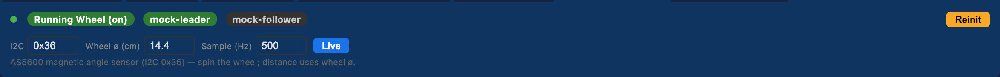

I²C magnetic encoder. Set the wheel diameter (it scales cm/s and distance) and the sample
rate, then **Live** and spin the wheel.

### Calibration Probe

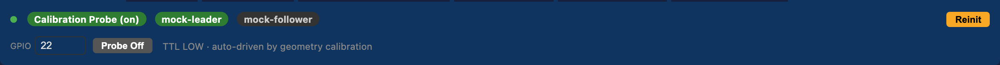

A single GPIO that **latches** high or low — a TTL marker for aligning an external
recording to a calibration session. It is driven automatically by the geometry
calibration; the button is for testing.

### Optogenetics

A laser (or LED driver) TTL on a leader GPIO plus an optional **masking LED** on a second
GPIO, both **boot-LOW** pins (17 / 27 by default — see
[LEADER_WIRING.md](LEADER_WIRING.md)); a blank Mask GPIO means no masking LED. **Max on** is a
hard cap per light window that the device and Deploy both enforce; **Show latency** seeds the
SHOW→photons estimate that times a laser leading the stimulus (the engine refines it from the
photodiode during the session). **Test laser** / **Test mask** fire one window (length,
continuous or pulsed) through the same device code the engine runs — the laser test asks for
confirmation. What the light does in a task (which trials, which windows, the pattern) is set in
the Experiment tab, whose OPTOGENETICS section appears only when this device is enabled **and**
assigned to the leader. Initialize claims the pins LOW and reads them back; nothing holds them
afterwards, so the engine can claim them at GO. Commissioning recipe and status:
[OPTOGENETICS.md](OPTOGENETICS.md).

### IR Illuminator

The camera's 850 nm LED on the IRDriver board: an MCP4725 DAC on the leader's I²C bus sets the
LED current, with no GPIO ([LEADER_WIRING.md](LEADER_WIRING.md)). The card appears once the
device is in the rig — Device Catalog → **IR Illuminator**, or the `ir_led` block that
`rigs/_template.yaml` ships with `enabled: false` — and works once it is switched on and
assigned to the **leader**.

| Control | What it does |
|---|---|
| **I2C** | The DAC's address (`0x60`). Rig YAML; Save Rig, then Reinit |
| **Intensity** slider | 0–100 % of the driver's dimming range (not calibrated light; 0 % is the dimmest lit level, not off). **Save Rig** keeps it as the rig's `intensity_pct`. On an initialized device every move goes to the Pi at once: the card answers `80 % = 2.10 V, LED ON`, or `… LED off (Live lights it)` while dark. Before Initialize it only edits the rig value |
| **Live** / **Stop** | Live lights the LED at the slider's value, for aiming and focusing with the Camera card's preview next to it; the card shows **LED ON** in red and the Log prints `IR LED ON at 60 % (DAC 1.7 V). 850 nm is invisible: never look into the LED.` Stop switches it off |

- **Only Live lights the LED here.** Initialize and Reinit set the DAC to 0 V, make its
  power-up value 0 and leave the LED **off**, also when it was lit. The Camera card's own Live
  does not light it (the Experiment tab's camera preview does).
- A session takes the LED over: on at START, off at the end. While one runs the card cannot
  light or re-initialize it (the Pi answers *a session is running — the engine owns the IR
  LED*).
- Initialize fails on a rig that lists the device without a board
  (`MCP4725 at 0x60 on I2C-1: …`), and so would GO: keep `enabled` off until the board is
  fitted.
- *the pi_api on <pi> has no IR LED routes — Deploy this rig.* means the leader's code is
  older than the IR illuminator.
- **850 nm is invisible.** Never look into the LED; judge on/off by the card or the camera
  image, not by eye.

Wiring, the safety model (what switches a left-on LED off, and what does not), the bench
bring-up of a new board and the commissioning steps: [IR_LED.md](IR_LED.md). Not yet tried on
hardware as of 2026-11-18.

---

## Geometry calibration and the warp map

The rig is **rear-projected** onto a curved screen, so a stimulus at a requested azimuth
only lands correctly once the geometry is registered and a warp map is built.

1. In **CALIBRATION**, press **Calibrate**. The follower's X server restarts, the probe
   latches HIGH, and a popup opens the landmark tool served from the Pi at port `5091`.
2. Register the landmarks there and press its Save — the result posts back and is written
   as a timestamped `rig_geometry_<date>.yaml` alongside the canonical file.
3. Press **↻** to refresh the **File** list, pick the new geometry.
4. Press **Generate Warp**. The controller computes `warp_map.npz` locally, copies it to
   every Pi and asks each to reload it. The status line flips to a green
   *"warp_map.npz found on Leader"*.

**Send to projector** pushes a geometry file to the display Pi without regenerating the
warp — useful when only the model changed. Parameter meanings are in
[display_calibration/geometry_params.md](../display_calibration/geometry_params.md);
the full procedure is in [CALIBRATION_PROTOCOL.md](CALIBRATION_PROTOCOL.md).

## Intensity calibration

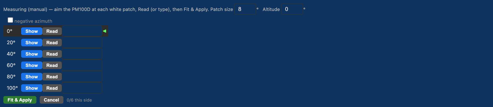

The projector is brighter at the centre than at the edges, its light is not proportional to its
drive, and drive 0 still leaves a black floor. One intensity calibration measures all of it, and
the light model built from it makes the background uniform in light and defines brightness and
contrast on light (details: [CALIBRATION_PROTOCOL.md, Part 2](CALIBRATION_PROTOCOL.md)).

- **Calibration** lists the rig's files: measured ones, and the `theoretical` (geometry model, the
  default) and `none` mocks. **Apply** rebuilds and deploys the warp with the selected file and
  makes it the rig's (`devices.display.intensity_calibration`, saved at once). The line below shows
  the uniform range Bg 0..1 spans.
- **Measure…** opens the measurement panel, at one **Alt** for the whole calibration. One column
  per azimuth (0°, 40°, 80° by default; edit the header, **+ column**, × to remove — two columns
  minimum, three or more out to the screen edge recommended): light at drive 1.0 … 0.0 there
  (**+ level** / × edit the rows; 1.0 and 0.0 stay). ▶ shows a cell's patch (raw), R reads the
  Thorlabs PM100D and advances, or type the value. **Save** writes
  `display_calibration/<rig>/intensity/intensity_cal_<stamp>.yaml` and logs a fit report;
  **Save & Apply** also applies it.
- The TESTS row follows the applied calibration: **Bg** is a brightness, **Contrast %** is contrast
  of light, and the row shows the background's and the stimulus's light plus the drive at the test
  azimuth.

---

## Running without a rig

`rigs/demo.yaml` (created from the tracked `rigs/_demo_template.yaml` by the smoke test) plus `tools/mock_pi.py` gives a fully interactive UI with no hardware —
useful for demos, for finding your way around, and for regenerating these screenshots.
Both of its Pis are `127.0.0.1`, so a mis-click cannot reach the real rig.

```bash
python tools/mock_pi.py     # fake pi_api on :5080
python controller/app.py    # Setup tab -> Load rig -> demo -> Initialize
```

What does not work under the mock: Install / Reboot / Shutdown (real SSH), Generate Warp
and Intensity Cal (they compute locally, then fail at the copy step), the camera preview
(the mock serves no MJPEG), and the warp status, which always reads *not found*.

---

## Troubleshooting

| Symptom | Cause / fix |
|---|---|
| Everything greyed out | No rig loaded — **Load Rig** first |
| **Initialize** stays disabled | At least one Pi is not answering on port 5080. Press **Check**; then `sudo systemctl status vrfarm` on the Pi |
| Device card says *"Waiting for Pi check..."* | Same cause — the panel unlocks only after a successful Initialize |
| Devices go grey by themselves | You pressed **Deploy** or **Restart API**. Press **Initialize** again |
| *"SSH FAIL, API OK"* | The key or `known_hosts` entry is missing. Only **Install** needs SSH — see [CONTROLLER_SETUP.md §2](CONTROLLER_SETUP.md#2-passwordless-ssh-to-the-pis) |
| Install fails on a `sudo` step | `vruser` needs passwordless sudo — [INITIAL_SETUP_REFERENCE.md](INITIAL_SETUP_REFERENCE.md#new-pi-first-boot-headless-bring-up) step 5 |
| A device won't initialize | Confirm it is assigned to a Pi (click the Pi chip in its card), then check pins and packages |
| Camera preview is a broken image | Expected under the mock. On the real rig, press **Stop** then **Live**, or **Reinit** the camera |
| Warp status red on a working rig | `/api/check_warp` looks only on the Pi with `role: leader` |
| Edits vanished | You did not press **Save Rig** |

---

**Next:** [Experiment UI](EXPERIMENT_UI.md) · [Calibration protocol](CALIBRATION_PROTOCOL.md) · [Docs index](README.md)
